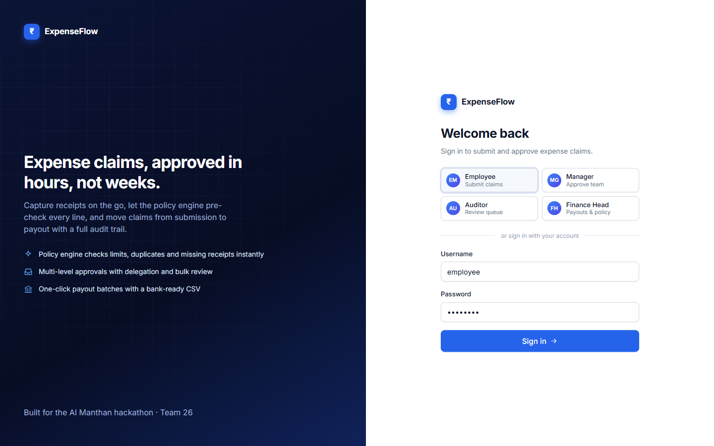
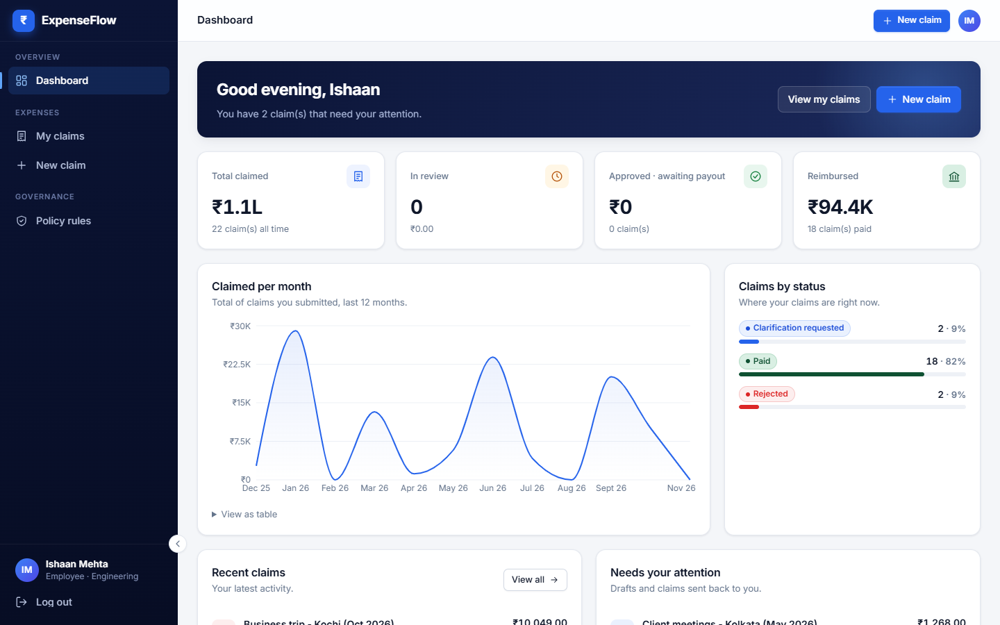
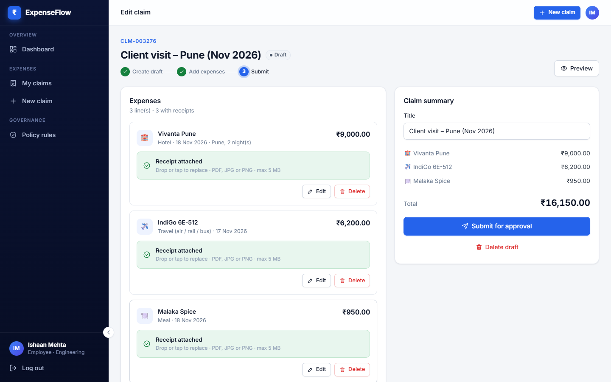
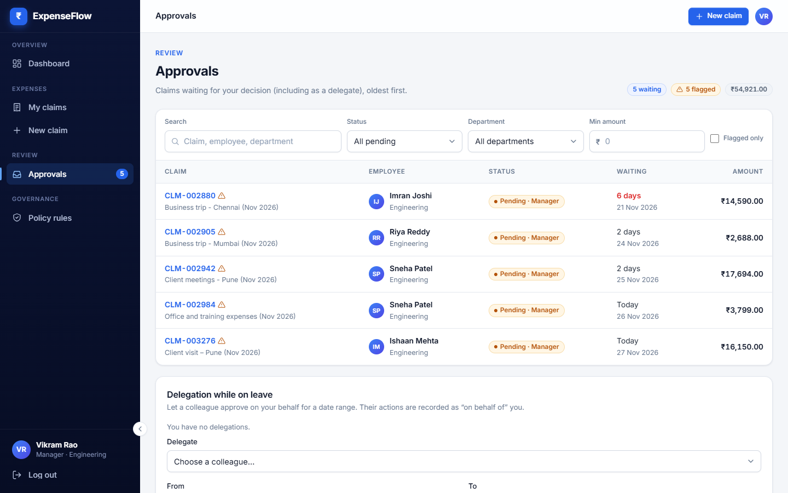
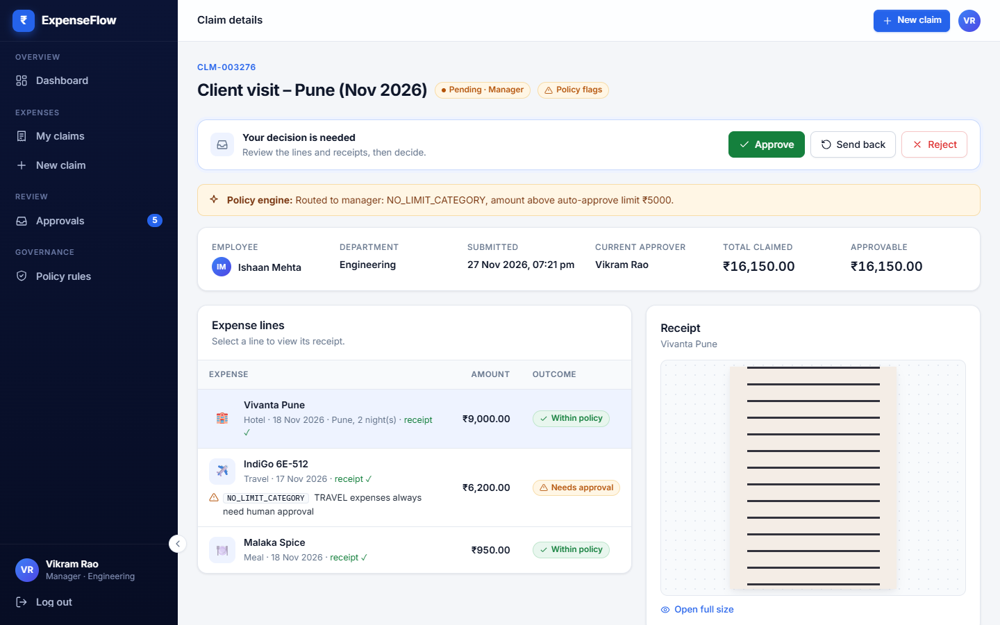
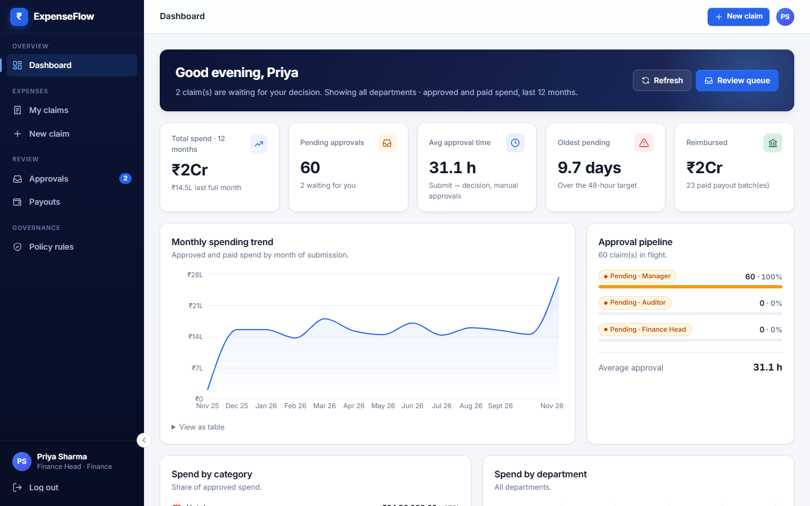
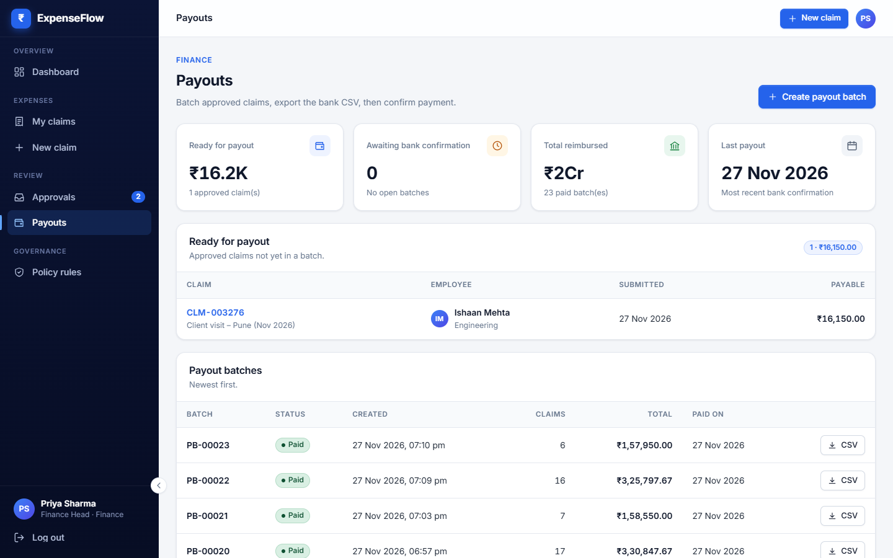

# ExpenseFlow — User Guide

ExpenseFlow handles employee expense claims from start to finish:
- an employee submits a claim with receipts
- a policy engine checks every expense line
- the claim moves through manager, auditor and Finance Head approvals
- the Finance Head pays approved claims in batches and exports a bank CSV

This guide shows how to **run the app** and **use it with each role**.

---

## 1. Before you start

| You need | Version | Check |
|---|---|---|
| Docker Desktop (running) | any recent | `docker --version` |
| Node.js | 18.18 or newer (20 LTS recommended) | `node -v` |

The backend (Java 17) and the database (PostgreSQL 16) run inside Docker, so you don't need Java or Maven on your machine.

---

## 2. Run the app

Open **two terminals** in the project folder.

**Terminal 1: database and backend**

```powershell
docker compose up -d --build
docker compose logs -f backend      # wait for "Started ExpenseFlowApplication", then press Ctrl+C
```

On the first start, the app loads demo data: 150 employees, 8 departments and 3,000 historical claims. This takes about 5 seconds. Later starts keep your existing data.

**Terminal 2: frontend**

```powershell
cd frontend
npm install        # first time only
npm run dev
```

**Open http://localhost:5173**

To check the backend on its own, open `http://localhost:8080/actuator/health`. It should show `{"status":"UP"}`.

**To stop:** press `Ctrl+C` in terminal 2, then run `docker compose stop` in terminal 1. Your data is kept.

> ⚠️ `docker compose down -v` **deletes all data** (the database and the uploaded receipts). Use it only when you want a fresh demo.

---

## 3. Sign in

Every demo account uses the password **`Demo@123`**. On the login page, the quick buttons fill in the username and password for you.

| Username | Person | Role | What they do |
|---|---|---|---|
| `employee` | Rohan Gupta | Employee | Submits claims |
| `manager` | Vikram Rao | Manager | Approves their team's claims |
| `auditor` | Anil Kumar | Finance Auditor | Reviews claims above ₹25,000 and sample audits |
| `financehead` | Priya Sharma | Finance Head | Approves claims above ₹1,00,000, runs payouts, edits policy limits |

The other 146 seeded users (for example `ishaan.mehta` or `maria.sharma`) use the same password.



---

## 4. Employee: submit a claim

The **Dashboard** shows what you have claimed, what is in review, what is approved and what has been reimbursed. It also shows your monthly trend and recent claims.



**To submit a claim:**
1. Click **New claim**, type a title such as "Client visit – Pune", then click **Create draft**.
2. Add each expense:
   - pick a category (Meal, Hotel, Local cab, Travel or Other)
   - enter the date, amount and vendor
   - for hotels, also enter the city and number of nights
   - click **Add expense**
3. Drop the receipt onto each expense, or tap to browse (PDF, JPG or PNG, up to 5 MB).
4. Click **Submit for approval** and confirm.



After you submit, the policy engine checks every line straight away. The claim page then shows:
- **✓ Within policy:** no issues.
- **⚠ Needs approval:** for example over a limit, a weekend expense, or a Travel line. The claim goes to your manager.
- **✕ Auto-rejected:** for example a missing receipt above ₹500, or a receipt file that was already used.

If a reviewer **sends the claim back**, their comment appears at the top of the claim. Edit the claim and click **Resubmit**.

---

## 5. Manager: review and approve

**Approvals** lists the claims waiting for you, oldest first. ⚠ marks claims with policy flags. You can search, or filter by status, department or minimum amount.



Open a claim to see each expense next to its receipt. Click a line to show that line's receipt. Then choose:
- **Approve** (a comment is optional)
- **Send back** (a comment is required)
- **Reject** (a comment is required)



**Going on leave?** At the bottom of the Approvals page, under **Delegation while on leave**, pick a colleague and a date range. They can approve on your behalf, and the claim's history records "Approved by … on behalf of …".

---

## 6. Approval chain

| Claim amount (approved lines) | Who approves |
|---|---|
| Up to ₹5,000 and within policy | Approved automatically. 10% are randomly sent to an auditor for a sample check. |
| Up to ₹25,000 | Manager |
| Above ₹25,000 | Manager → Finance Auditor |
| Above ₹1,00,000 | Manager → Finance Auditor → Finance Head |

Nobody can approve their own claim. Auditors can **bulk approve**: select rows, then click **Approve selected**. Claims with policy flags are skipped, and the reason is shown.

**Policy limits.** These are editable by the Finance Head on **Policy rules**:
- meals ₹1,500 per day
- hotel ₹6,000 per night in tier-1 cities, ₹4,000 per night elsewhere
- local cab ₹2,000 per trip
- receipt required above ₹500

---

## 7. Finance Head: analytics and payouts

The **Dashboard** shows total spend, pending approvals, average approval time, the oldest pending claim and the total reimbursed. It also has charts by month, category and department, and policy violations by rule.



**To pay approved claims:**
1. Open **Payouts**. "Ready for payout" lists the approved claims.
2. Click **Create payout batch** and confirm.
3. Click **CSV** to download the bank file (`payout_PB-xxxxx.csv`).
4. When the bank confirms payment, click **Mark paid**. Every claim in the batch becomes **Paid**.



---

## 8. Troubleshooting

| Problem | Fix |
|---|---|
| `node` or `npm` is not recognized | Install Node.js 20 LTS, or open a new terminal so it picks up the updated PATH. |
| `npm install` / `npm ci` fails with **EPERM** | Another dev server is still running and has files locked. Stop it (`Ctrl+C`, or close its terminal) and try again. |
| `'vite' is not recognized` | Packages are missing. Run `npm install` in `frontend`. |
| The page says "Cannot reach the server" | The backend isn't running. Run `docker compose up -d` and wait about 20 seconds. |
| The login screen keeps coming back | Check the username, and that the password is `Demo@123` (unless you changed `APP_DEMO_PASSWORD` in `.env`). |
| Port 5173 or 8080 is already in use | Close the other app using it. Vite will offer the next free port. |
| You want the original demo data back | Run `docker compose down -v`, then `docker compose up -d --build`. **This erases everything.** |

---

Test reports and QA evidence are in [docs/testing/](testing/).
