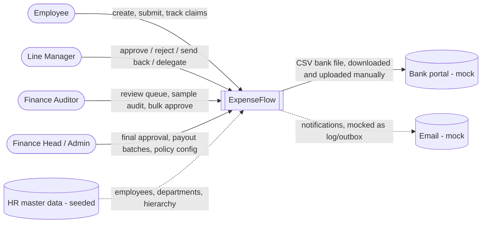
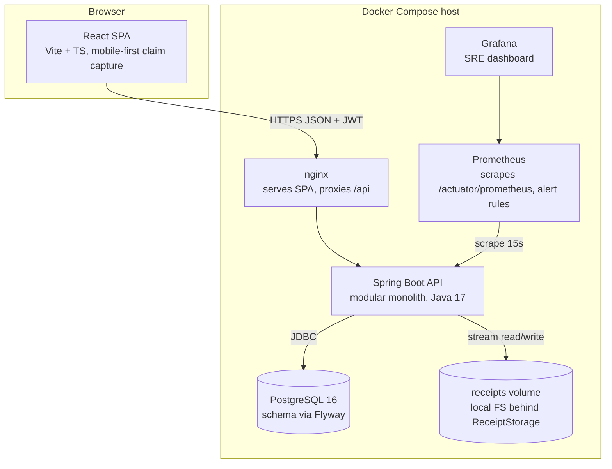
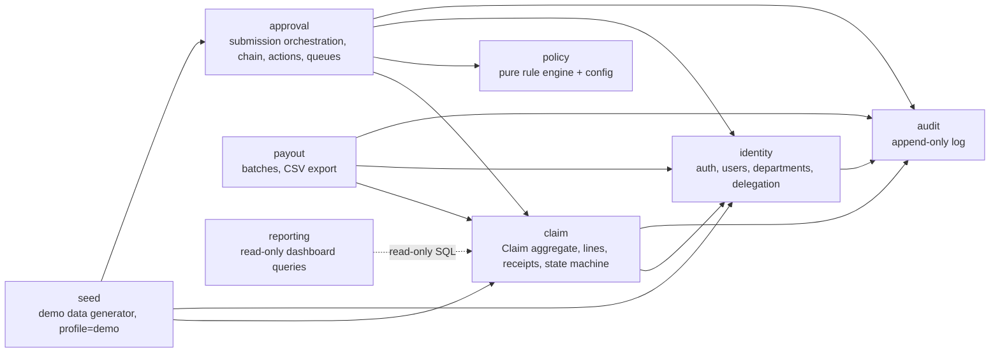
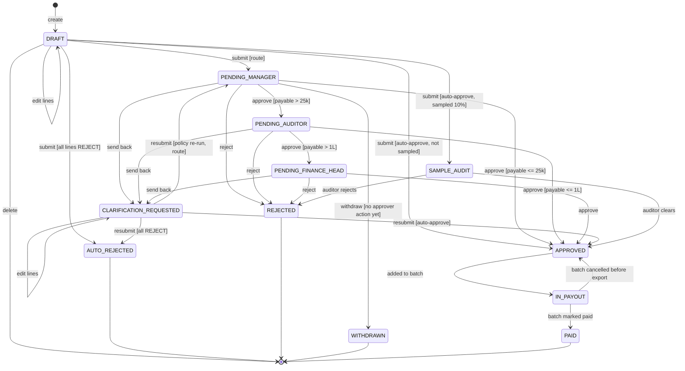

# ExpenseFlow — Detailed Architecture Design (Step 3)

Builds on [01-requirements-analysis.md](01-requirements-analysis.md) (business rules, defaults A1–A17,
bypass list B1–B21) and the approved option set in [02-architecture-options.md](02-architecture-options.md).
Decisions with lasting impact are recorded as ADRs in [../adr/](../adr/).

Stack: Java 17 · Spring Boot 3 · Spring Security · Spring Data JPA · Flyway · PostgreSQL 16 · React + Vite + TypeScript ·
Docker Compose · GitHub Actions · Micrometer/Prometheus/Grafana.

---

## 1. System Context (C4 level 1)



Out of scope: real bank integration, real email, SSO, OCR, multi-currency.

## 2. Containers (C4 level 2)



| Container | Responsibility | Owner |
|---|---|---|
| React SPA | All UI; no business decisions (policy preview comes from API) | Both (after backend) |
| nginx | Static hosting, `/api` reverse proxy → same origin, no CORS in prod | Dev B |
| Spring Boot API | All business logic, auth, audit | Both |
| PostgreSQL | System of record; append-only `audit_log` enforced by trigger | Dev A (schema) |
| Receipts volume | Receipt binaries, random keys | Dev B |
| Prometheus + Grafana | Metrics, alert on oldest pending approval | Dev B |

## 3. Backend Module Map (C4 level 3)

Base package `com.expenseflow`. Each module has `web` (controllers + DTOs), `service`, `domain` (entities, enums,
pure logic), `repo`. **Modules talk only through another module's `service` classes, never its `repo`.**
Guarded by an ArchUnit test.



| Module | Key classes (design names) | Owner |
|---|---|---|
| `common` | `Money`, `ProblemDetail` handler, `CurrentUser`, clock abstraction (testable dates) | Dev A |
| `identity` | `User`, `Department`, `Delegation`, `JwtService`, `SecurityConfig`, `DelegationService` | Dev B |
| `policy` | `PolicyEngine`, `RuleEvaluator` (one per rule type), `PolicySet`, `HistorySnapshot`, `PolicyConfigService` | Dev A |
| `claim` | `Claim` (aggregate root), `ClaimLine`, `Receipt`, `ClaimStatus`, `ClaimStateMachine`, `ReceiptStorage`, `ClaimAccessPolicy` | Dev B (state machine: Dev A) |
| `approval` | `SubmissionService`, `ApprovalChainBuilder`, `ApprovalStep`, `ApprovalActionService`, `InboxQueryService`, `SampleAuditSelector` | Dev A |
| `payout` | `PayoutBatch`, `PayoutItem`, `BankFileWriter` | Dev A |
| `reporting` | `SpendReportService`, `ViolationReportService`, `ApprovalTimeReportService`, `QueueMetrics` (Micrometer gauges) | Dev B |
| `audit` | `AuditLog`, `AuditService` (same transaction, `Propagation.MANDATORY`) | Dev B |
| `seed` | `DemoDataGenerator` (fixed random seed) | Dev B |

Pure-Java rule: `policy.domain`, `ClaimStateMachine` and `ApprovalChainBuilder` have **no Spring, JPA or I/O imports**.
That keeps the TDD tests fast and deterministic.

## 4. Claim State Machine



`SUBMITTED` from the requirements diagram is **not persisted**: submit and the policy decision happen in one transaction.
The policy outcome is stored separately in `claim.policy_outcome`, either `AUTO_APPROVE`, `ROUTE` or `AUTO_REJECT`.
Auto-approved claims are therefore reportable without needing their own status.
Resubmitting a claim after clarification can also send it to `SAMPLE_AUDIT`. That transition is left out of the diagram to keep it readable.

### Transition guards (enforced in `ClaimStateMachine` + `ApprovalActionService`)

| Event | Allowed from | Actor guard | Other guards / effects |
|---|---|---|---|
| edit / delete | DRAFT, CLARIFICATION_REQUESTED (edit only) | claimant | — |
| submit / resubmit | DRAFT / CLARIFICATION_REQUESTED | claimant | ≥1 line; policy evaluated; open steps cancelled (resubmit); new chain built; sample decision only on **first** auto-approve |
| approve | PENDING_* | `canAct(user, currentStep)` | actor ≠ claimant; `@Version` check; next step or APPROVED; `decided_at` set when APPROVED |
| reject / send back | PENDING_* | `canAct` | **comment mandatory** |
| withdraw | PENDING_MANAGER | claimant | no step has `acted_at` |
| sample clear / reject | SAMPLE_AUDIT | FINANCE_AUDITOR, ≠ claimant | — |
| add to batch / cancel / mark paid | APPROVED / IN_PAYOUT | FINANCE_HEAD | claim in at most one active batch (unique) |

Every transition: (1) checks the table, (2) mutates through the `Claim` methods (setters are private),
(3) writes `audit_log` in the same transaction. Any failure rolls back all three.

## 5. Approval Chain

### Building the chain at submit (`ApprovalChainBuilder`, pure)
Input: claimant, payable amount, `approval_config`, org lookups. Output: ordered list of steps.

1. Level 1 `MANAGER`: assigned to `claimant.manager`. If the claimant has no manager (CEO), the step goes to the Finance Head.
2. Level 2 `AUDITOR`, added if payable > `auditor_threshold` (25,000). It is assigned to the **auditor pool**: `assigned_role = FINANCE_AUDITOR` and no user. Any auditor except the claimant can act.
3. Level 3 `FINANCE_HEAD`, added if payable > `finance_head_threshold` (1,00,000). It is assigned to the Finance Head. If the claimant **is** the Finance Head, it goes to the configured `escalation_user` (the CEO).
4. **Merge rule**: if the same person would approve two consecutive levels, the levels are merged into one step with `merged_levels` recorded. This happens, for example, when someone reporting directly to the Finance Head claims more than 1L. Approving twice adds no control, and the merge is visible in the audit trail.
5. No step may be assigned to the claimant. If one would be, it escalates to the next eligible person, and the builder fails if there is nobody.

All steps are inserted at submit with status `WAITING`. The first becomes `OPEN`. The full chain is shown to the employee.

### Who can act (`canAct`, resolved at action time)
```
canAct(user, step) =
    user != claimant
AND step.status == OPEN
AND user is active and still holds the role (loaded from DB per request)
AND user has not acted on another step of this claim in this round      -- review N2
AND ( step.assigned_user == user
   OR (step.assigned_user is null AND user has step.assigned_role)
   OR exists delegation(delegator = step.assigned_user, delegate = user,
                        valid_from <= now < valid_to, active) )
```
The inbox query uses the same predicate in SQL, so what a user sees and what they can act on never disagree.

### Delegation rules
- Created by the delegator or the admin. Time-bound. `valid_from` must not be in the past, so delegations cannot be backdated. One active delegation per delegator, and the delegate may not delegate onward.
- The delegate must hold the role of the level being delegated. Exception: the Finance Head may delegate to a Finance Auditor, and this is recorded in an ADR.
- A delegate never acts on their own claim (`canAct` checks claimant first).
- Steps are stored as `acted_by = delegate` with `on_behalf_of = delegator`.

### Send back for clarification
The open step closes with `SENT_BACK`, and the remaining `WAITING` steps become `CANCELLED`. They are kept as history.
On resubmit the policy runs again and a fresh chain is built from level 1 (requirements A9, closes B4).

## 6. Policy Engine

### Pipeline
```
SubmissionService (transactional)
  1. load claim + lines (lock: optimistic @Version)
     pg_advisory_xact_lock(employee_id) + one per receipt sha256   -- review N1: no parallel-submit race
     verify every line's receipt was uploaded_by the claimant        -- review N4
  2. HistorySnapshot = repo queries (exclude DRAFT and WITHDRAWN claims -- review N7):
       - prior lines with same receipt sha256      (company-wide, incl. rejected)
       - prior lines with same vendor_norm+amount+date (company-wide)
       - employee's auto-approved total this month (auto_approve_monthly_cap -- review N3)
       - employee's meal totals per date across other non-rejected claims
       - employee's claims in last N days (split detection)
  3. PolicySet = active rules + approval_config (cached, versioned)
  4. PolicyEngine.evaluate(claim, history, policySet)  -> ClaimDecision   [pure]
  5. persist line outcomes + line_violation rows (with rule version)
  6. ClaimStateMachine.apply(decision) ; ApprovalChainBuilder if ROUTE
  7. SampleAuditSelector (SecureRandom) if AUTO_APPROVE and first submission
  8. audit_log rows
```
`POST /claims/{id}/evaluate` (preview) runs steps 1–4 only and returns the decision without saving anything.

### Outcome combination
- Rule result ∈ `PASS < FLAG < ROUTE < REJECT`. Each line gets the most severe result from its rules.
- FLAG lines are payable but block auto-approve. They show a badge to the approver.
- Claim: all lines REJECT → `AUTO_REJECT`. `ROUTE` if any line is FLAG/ROUTE, payable > `auto_approve_limit`,
  or the employee's auto-approved total this month plus this claim > `auto_approve_monthly_cap`. Otherwise `AUTO_APPROVE`.
- `payable_amount` = sum of the non-REJECT lines, and this amount drives the approval thresholds.
- **Fail closed**: unknown rule type, invalid params, or an exception inside an evaluator → that line is ROUTEd with violation `POLICY_ERROR`. It is never auto-approved.

### Rule types and seeded configuration

| Rule code | rule_type | category | params (JSONB) | action |
|---|---|---|---|---|
| MEAL_DAILY_LIMIT | CATEGORY_DAILY_LIMIT | MEALS | `{"limit": 1500}` | ROUTE |
| HOTEL_NIGHTLY_LIMIT | PER_UNIT_LIMIT_BY_CITY_TIER | HOTEL | `{"limits": {"TIER_1": 6000, "OTHER": 4000}, "unitField": "nights"}` | ROUTE |
| CAB_TRIP_LIMIT | PER_TXN_LIMIT | LOCAL_CAB | `{"limit": 2000}` | ROUTE |
| RECEIPT_REQUIRED | RECEIPT_REQUIRED_ABOVE | * | `{"threshold": 500}` | REJECT |
| DUP_RECEIPT_HASH | DUPLICATE_RECEIPT_HASH | * | `{}` | REJECT |
| DUP_VENDOR_AMOUNT_DATE | DUPLICATE_VENDOR_AMOUNT_DATE | * | `{"amountTolerancePct": 0, "dateToleranceDays": 0}` | ROUTE |
| WEEKEND_SPEND | WEEKEND_FLAG | * | `{"days": ["SATURDAY","SUNDAY"]}` | FLAG |
| EXPENSE_DATE_SANITY | DATE_SANITY | * | `{"maxAgeDays": 90, "allowFuture": false}` | REJECT |
| UNLIMITED_CATEGORY | ALWAYS_ROUTE | AIRFARE, OTHER | `{"requireDescription": true}` | ROUTE |
| SPLIT_SUSPICION | CLAIM_SPLIT_WINDOW (stretch) | * | `{"windowDays": 7, "threshold": 25000}` | FLAG |

Boundaries (all "strictly greater than", matching the spec's wording): meals 1,500.00 passes and 1,500.01 routes.
A receipt is required at 500.01. The auditor is required at 25,000.01 and the Finance Head at 1,00,000.01.

`approval_config` (versioned key/value): `auto_approve_limit=5000`, `auto_approve_monthly_cap=15000`,
`auditor_threshold=25000`, `finance_head_threshold=100000`, `sample_audit_rate=0.10`, `escalation_user=<CEO emp_code>`.

`city` (reference table): `name, tier`. Tier-1 seed: Mumbai, Delhi, Bengaluru, Chennai, Kolkata, Hyderabad, Pune, Ahmedabad.

### Changing policy at runtime
`PUT /admin/policy-rules/{code}`: validates params against that rule type's schema, inserts a new row with `version+1`,
deactivates the old row, evicts the cache, and writes an audit row with before/after.
Claims that were already evaluated keep the `rule_version` stored on their violations.

## 7. Data Model (ERD)

```mermaid
erDiagram
    department ||--o{ app_user : has
    app_user ||--o{ app_user : manages
    app_user ||--o{ delegation : delegates
    app_user ||--o{ claim : submits
    claim ||--|{ claim_line : contains
    receipt ||--o{ claim_line : supports
    claim_line ||--o{ line_violation : has
    claim ||--o{ approval_step : routed_through
    claim ||--o| payout_item : paid_by
    payout_batch ||--|{ payout_item : contains
    expense_category ||--o{ claim_line : classifies
    city ||--o{ claim_line : located_in

    department { bigint id PK; varchar code UK; varchar name }
    app_user { bigint id PK; varchar emp_code UK; varchar email UK; varchar full_name; varchar password_hash; bigint department_id FK; bigint manager_id FK; varchar_arr roles; varchar bank_account; varchar ifsc; timestamptz bank_updated_at; boolean active }
    delegation { bigint id PK; bigint delegator_id FK; bigint delegate_id FK; timestamptz valid_from; timestamptz valid_to; boolean active; timestamptz created_at }
    expense_category { varchar code PK; varchar name; boolean requires_city }
    city { bigint id PK; varchar name UK; varchar tier }
    policy_rule { bigint id PK; varchar code; int version; varchar rule_type; varchar category; jsonb params; varchar action; boolean active; timestamptz effective_from; bigint created_by }
    approval_config { varchar key PK; int version PK; varchar value; boolean active }
    claim { bigint id PK; varchar claim_no UK; bigint employee_id FK; bigint department_id FK; varchar title; varchar status; varchar policy_outcome; numeric total_amount; numeric payable_amount; boolean sample_audit; int submission_count; timestamptz submitted_at; timestamptz decided_at; timestamptz paid_at; int version }
    claim_line { bigint id PK; bigint claim_id FK; bigint employee_id; varchar category FK; date expense_date; numeric amount; varchar vendor; varchar vendor_norm; bigint city_id FK; int nights; varchar description; uuid receipt_id FK; varchar outcome }
    receipt { uuid id PK; varchar storage_key UK; varchar original_name; varchar content_type; bigint size_bytes; char64 sha256; bigint uploaded_by; timestamptz uploaded_at }
    line_violation { bigint id PK; bigint line_id FK; varchar rule_code; int rule_version; varchar result; varchar message }
    approval_step { bigint id PK; bigint claim_id FK; int round; int seq; varchar level; varchar merged_levels; bigint assigned_user_id; varchar assigned_role; varchar status; bigint acted_by_id; bigint on_behalf_of_id; varchar action; text comment; timestamptz opened_at; timestamptz acted_at }
    payout_batch { bigint id PK; varchar batch_no UK; varchar status; int claim_count; numeric total_amount; char64 file_sha256; bigint created_by; timestamptz exported_at; timestamptz paid_at }
    payout_item { bigint id PK; bigint batch_id FK; bigint claim_id FK; numeric amount; varchar account_snapshot; varchar ifsc_snapshot; varchar beneficiary_snapshot }
    audit_log { bigint id PK; timestamptz ts; bigint actor_id; bigint on_behalf_of_id; varchar action; varchar entity_type; bigint entity_id; jsonb before_state; jsonb after_state; varchar ip; char64 prev_hash; char64 hash }
```

Key constraints and indexes:
- `claim_line.amount > 0`, `numeric(12,2)`; `claim.payable_amount <= total_amount` (CHECK).
- `payout_item`: partial unique index on `claim_id` where the batch is not CANCELLED, so a claim can never be paid twice (B16).
- `policy_rule (code, version)` unique; at most one active row per code (partial unique index).
- `delegation`: CHECK `delegator_id <> delegate_id` and `valid_to > valid_from`.
- Indexes: `claim(employee_id, status)`, `claim(status)`, `approval_step(status, assigned_user_id)`, `approval_step(status, assigned_role)`,
  `claim_line(vendor_norm, amount, expense_date)`, `claim_line(employee_id, category, expense_date)`, `receipt(sha256)`.
- `audit_log`: a trigger raises on UPDATE/DELETE, and the app DB role is granted only INSERT/SELECT on it.
  The hash chain is computed in `AuditService`, and serialized by an advisory lock or a single-row `audit_head` table.
- `approval_step.round` increments on each resubmit, so history from earlier rounds is never overwritten.

## 8. API Surface and Authorization Rules

All endpoints are under `/api/v1` and authenticated by JWT unless noted. **R** = required role; **O** = object-level rule (in `ClaimAccessPolicy`).

| Endpoint | R | O |
|---|---|---|
| `POST /auth/login` | public (rate-limited) | — |
| `GET /me` | any | — |
| `PUT /me/bank-details` | any | self only; the admin cannot edit bank details |
| `GET /claims` | any | query scoped `employee_id = me` |
| `POST /claims`, `PUT/DELETE /claims/{id}`, line CRUD | any | claimant AND status ∈ {DRAFT, CLARIFICATION_REQUESTED} |
| `GET /claims/{id}`, `/history` | any | claimant OR canAct on any step OR acted on it OR role ∈ {AUDITOR, FH} |
| `POST /claims/{id}/evaluate`, `/submit`, `/withdraw` | any | claimant |
| `POST /receipts` | any | — (owner = uploader) |
| `GET /receipts/{id}` | any | same as viewing a claim that references it, or uploader |
| `GET /approvals/inbox` | MANAGER/AUDITOR/FH | `canAct` predicate in SQL |
| `POST /claims/{id}/approve\|reject\|send-back` | MANAGER/AUDITOR/FH | `canAct(currentStep)` |
| `POST /approvals/bulk-approve` | AUDITOR/FH (and managers on own inbox) | each claim `canAct` AND no FLAG/ROUTE violations; returns per-claim result |
| `GET/POST/DELETE /delegations` | MANAGER/AUDITOR/FH | delegator = me (or admin) |
| `GET /audit-queue` (filters: dept, category, amount range, date, flag type, sample) | AUDITOR/FH | — |
| `POST /sample-audits/{claimId}/clear\|reject` | AUDITOR | ≠ claimant |
| `POST /payout-batches`, `GET /payout-batches/{id}/export.csv`, `POST .../mark-paid`, `.../cancel` | FH | — |
| `GET /reports/*` | MANAGER (own team only), AUDITOR, FH | team scoping for managers |
| `GET/PUT /admin/policy-rules`, `/admin/approval-config`, `/admin/users` | FH | — |
| `GET /audit-log` | AUDITOR/FH | — |
| `/actuator/health` public; `/actuator/prometheus` | internal network only | — |

Request DTOs never include `status`, `payable_amount`, `employee_id`, `outcome`, or `version` from the client
(the `version` field arrives through the `If-Match` header). Errors are returned as RFC 7807 `ProblemDetail`.
A wrong object returns `404`, not `403`, so the response does not reveal whether the claim exists.

## 9. Security Design

- **Auth flow**: login checks the BCrypt password and returns a JWT signed with HS256. The JWT has `sub, roles, exp` and expires after 60 minutes. The signing key comes from the `JWT_SECRET` env var, and startup fails if it is missing or shorter than 32 bytes. The SPA keeps the token in memory, plus `sessionStorage` so it survives a page refresh. Login is rate-limited per IP and per user.
- **Receipt upload pipeline**: size ≤ 5 MB → check magic bytes for PDF/JPEG/PNG → stream to the volume under a random UUID key, computing SHA-256 while streaming → save the `receipt` row. The original filename is stored only as metadata. Downloads go through the API with `Content-Disposition: attachment` and `X-Content-Type-Options: nosniff`. A receipt becomes immutable once it is linked to a submitted line.
- **CSV export**: cells that start with `= + - @ \t \r` are prefixed with `'`, which prevents CSV/formula injection.
- **Per-request user load**: the JWT proves identity only. The user's roles and `active` flag are read from the DB on each request (review N8).
- **Bank details**: only the employee can edit their own (`PUT /me/bank-details`). The admin cannot. Changes are audited, and the timestamp drives the payout flag (review N5).
- **Demo safety**: the `demo` profile, with known passwords, starts only when `DEMO_MODE=true` is set (review N14).
- **Amounts**: `> 0`, at most 2 decimals, upper bound 10,00,000 per line (Bean Validation and DB CHECK) (review N9).
- **Other**: Bean Validation on all DTOs; only parameterized JPA/JPQL; security headers; CORS only for the dev origin; no stack traces in errors; secrets only in `.env`, which is git-ignored, with `.env.example` committed; gitleaks runs in CI.

## 10. Payout Bank File (mock format)

`payout_<batch_no>.csv`, UTF-8, comma-separated, amounts with 2 decimals:
```
H,EXPFLOW,<batch_no>,<value_date yyyy-MM-dd>,<record_count>,<total_amount>
D,<txn_ref>,<beneficiary_name>,<account_no>,<ifsc>,<amount>,INR,<narration: claim_no>
...
T,<record_count>,<total_amount>
```
The header and trailer totals must equal the sum of the detail rows; a test asserts this. The file's SHA-256 is stored on the batch.
Bank details are snapshotted into `payout_item` when the batch is created. A beneficiary whose bank details changed in the last 7 days is flagged on the batch screen (B19).

Batch flow: `DRAFT` (claims → IN_PAYOUT) → `EXPORTED` (CSV downloaded; locked) → `PAID` (claims → PAID). `DRAFT` can be cancelled, which returns its claims to APPROVED.

## 11. Observability

| Metric (Micrometer) | Type | Use |
|---|---|---|
| `expenseflow_approval_queue_size{level}` | gauge | open steps per level |
| `expenseflow_approval_oldest_pending_seconds{level}` | gauge | **alert source** |
| `expenseflow_claims_submitted_total{outcome}` | counter | auto-approve/route/reject mix |
| `expenseflow_policy_violations_total{rule}` | counter | rule hit rate |
| `expenseflow_approval_duration_seconds` | histogram | submit → final decision |
| `http_server_requests_seconds` | histogram (built in) | page/API latency p95 |

Gauges are refreshed by a `@Scheduled` job every 60 s using one aggregate query, not by a query on every scrape.

Alerts, with thresholds still to be validated by the team:
- `OldestPendingApprovalHigh`: `max(expenseflow_approval_oldest_pending_seconds) > 172800` (48 h) for 15 min → warning. Above 72 h → critical.
- `ApiLatencyHigh`: p95 above 1 s for 10 min.

Logging: JSON logs with a request correlation ID (MDC), user ID and claim ID. No PII beyond the employee code.

## 12. Synthetic Data (`seed` module, profile `demo`)

- 8 departments: Engineering, Sales, Marketing, Finance, HR, Operations, Delivery, Legal.
- 150 users: 1 CEO, 1 Finance Head, 3 Finance Auditors (in the Finance dept), 8 department heads reporting to the CEO, about 20 managers, and the rest employees. Demo logins have known passwords, which are documented and used only in the demo profile.
- 3,000 historical claims over the past 12 months, run through the **real** policy engine and chain builder so the data is consistent. The planted cases are:
  - about 3% duplicates: half reuse the same receipt file, half repeat the same vendor, amount and date
  - about 5% limit breaches
  - about 10% weekend spend
  - some missing receipts
  - claims above 25k and 1L
  - a few stuck approvals more than 3 days old, so the alert fires in the demo
- Decisions on historical claims are spread over time, so the approval-time metrics are meaningful.
- Fixed random seed, so the result is reproducible. The generator is idempotent: it skips if the data is already seeded.

## 13. Testing Strategy (summary)

| Layer | Scope | Tooling |
|---|---|---|
| Unit (written first) | each rule type with boundary values; outcome combination; `ClaimStateMachine` (every allowed and forbidden transition); `ApprovalChainBuilder` (thresholds, merge, escalation, CEO, FH-own-claim); `canAct` incl. delegation windows | JUnit 5, AssertJ, parameterized |
| Integration | repositories, history snapshot queries, audit trigger rejects UPDATE, unique payout constraint, Flyway migrations | Testcontainers PostgreSQL |
| API security | authorization matrix: role × endpoint × own/other/assigned claim; IDOR; self-approval; mass assignment | MockMvc |
| E2E (10 cases) | E1 clean small claim auto-approved → paid · E2 30k routed manager → auditor → paid · E3 1.2L full chain · E4 duplicate receipt auto-rejected · E5 send back → edit → resubmit restarts chain · E6 delegation on leave · E7 sample audit reject · E8 bulk approve skips flagged · E9 employee cannot open another's claim · E10 payout CSV totals and Paid status | Playwright (E1, E3, E5, E9) + RestAssured API journeys (rest) |

## 14. Repository Layout

```
backend/            Spring Boot (Maven), modules as packages under com.expenseflow
  src/main/resources/db/migration   Flyway V1__schema.sql, V2__reference_data.sql, V3__policy_seed.sql
frontend/           React + Vite + TS, generated API types in src/api/generated
docs/architecture/  01 requirements, 02 options, 03 this document
docs/adr/           decision records
docs/reviews/       skeptical-auditor review, security checklist, defect log
ops/                prometheus.yml, alert rules, grafana dashboards
docker-compose.yml  db, api, web, prometheus, grafana
.github/workflows/  ci.yml
CLAUDE.md           business rules + coding rules for Claude
```

## 15. Build Order (backend-first)

1. Skeleton, Flyway schema, reference data, `CLAUDE.md`, CI with build and tests. *(A + B)*
2. **Policy engine unit tests → engine** *(A)* ∥ identity/JWT, users, seed of org data *(B)*
3. Claim aggregate, receipts and hashing, state machine *(B, state machine A)* ∥ chain builder and `canAct` tests *(A)*
4. Submission orchestration, approval actions, delegation, send back *(A)* ∥ audit log, inbox and audit queue, sample audit *(B)*
5. Payout and CSV *(A)* ∥ reports, metrics, historical claim seeding *(B)*
6. OpenAPI → TS types; React screens
7. E2E, security checklist, Compose and observability, runbook
